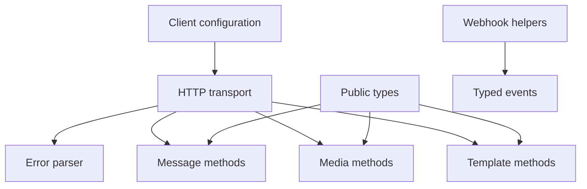

# WhatsApp Cloud API Wrapper SDK — V1 Plan

Status: **planning only — implementation is not approved**  
Research snapshot: **2026-09-29**  
Primary sources: official Meta documentation through Meta Social Technologies MCP

## V1 outcome

V1 is a small server-side SDK that maps typed application calls to the WhatsApp Cloud API. It validates inputs, builds Meta payloads, parses responses, exposes consistent errors, and provides webhook verification/parsing helpers.

The SDK is stateless. It has no database, queue, worker, hosted API, dashboard, tenant system, issued API keys, or message-status store.

## V1 features

| Feature | Decision | Document |
|---|---|---|
| Approved-template sending and direct template management methods | Include | [01-template-messaging.md](01-template-messaging.md) |
| Seven common message types | Include | [02-basic-message-sending.md](02-basic-message-sending.md) |
| Webhook verification and payload parsing helpers | Include | [03-webhook-infrastructure.md](03-webhook-infrastructure.md) |
| Message response/status types without persistence | Include | [04-message-tracking.md](04-message-tracking.md) |
| Typed Meta errors and conservative optional retries | Include | [05-retry-failure-handling.md](05-retry-failure-handling.md) |
| Queue and worker | Exclude | [06-queue-processing.md](06-queue-processing.md) |
| Direct media methods | Include | [07-media-management.md](07-media-management.md) |
| Per-client and per-call phone-number selection | Include | [08-multi-phone-number.md](08-multi-phone-number.md) |
| Meta token configuration; SDK-issued keys excluded | Include | [09-api-authentication.md](09-api-authentication.md) |
| Dashboard | Exclude | [10-dashboard.md](10-dashboard.md) |

See [11-system-design.md](11-system-design.md), [12-review-gate.md](12-review-gate.md), and [13-meta-mcp-cross-check.md](13-meta-mcp-cross-check.md).

## Dependency graph



## Package boundary

```text
Application -> WhatsApp SDK -> Meta Graph API
                    |
                    +-- messages
                    +-- templates
                    +-- media
                    +-- webhooks
                    `-- errors
```

## Proposed public surface

```text
WhatsAppClient
  messages.sendText|sendImage|sendDocument|sendVideo|sendAudio
  messages.sendLocation|sendContacts|sendTemplate
  templates.list|get|create|update|delete
  media.upload|retrieve|download|delete

webhooks.verifyChallenge|verifySignature|parse
```

Template mutation remains conditional until its V1 schemas are approved. Listing, retrieving, and sending approved templates are core.

## Implementation phases

1. Close [12-review-gate.md](12-review-gate.md).
2. Build configuration, HTTP transport, timeout/cancellation, and typed errors.
3. Live-test and implement `messages.sendText`.
4. Add webhook verification and message/status parsing.
5. Add approved-template sending.
6. Add remaining messages and media operations.
7. Add approved template-management operations.
8. Publish API reference, examples, compatibility statement, and release checks.

## Non-goals

Hosted infrastructure, persistence, internal message IDs, status history, queues, workers, automatic background retries, web servers, webhook hosting, API-key issuance, multi-tenancy, dashboards, template synchronization, CRM/inbox, campaigns, onboarding, commerce, bots, analytics, and multi-channel abstractions.
